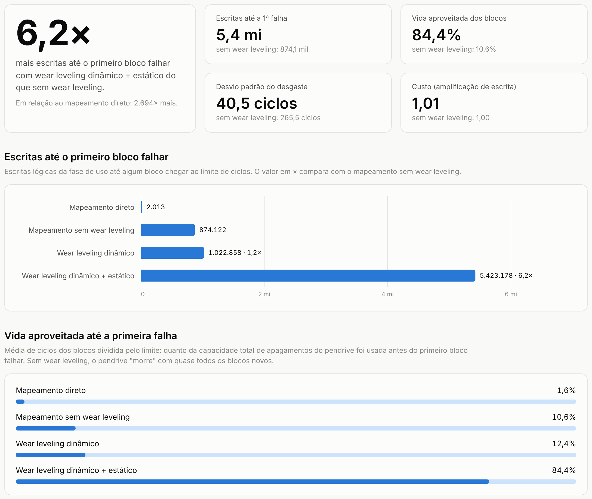
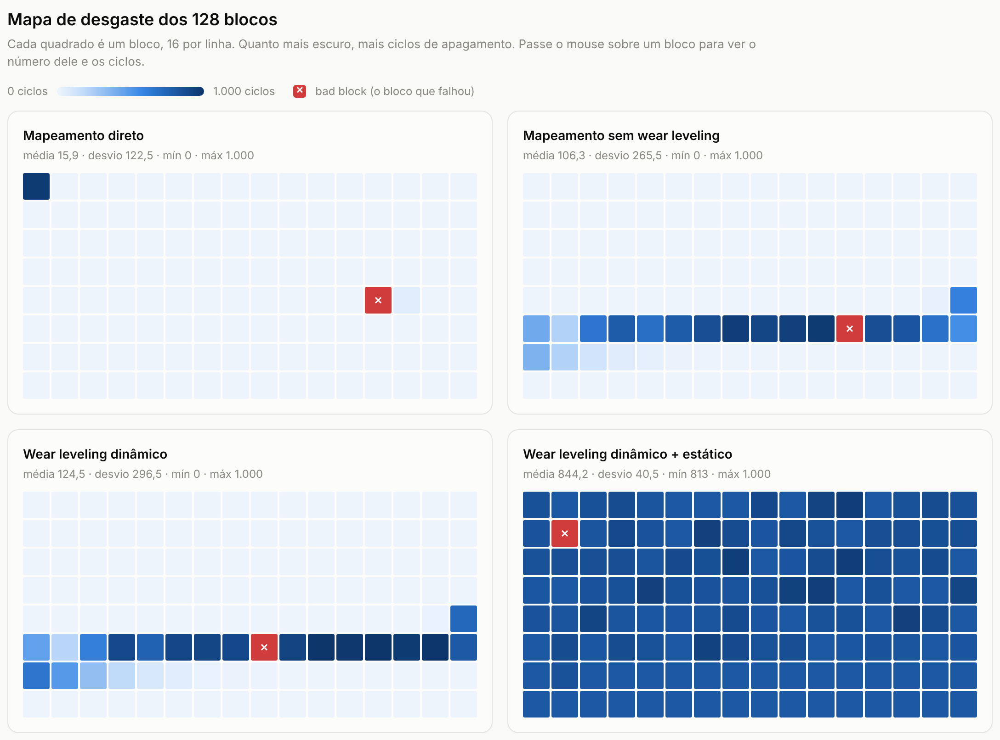
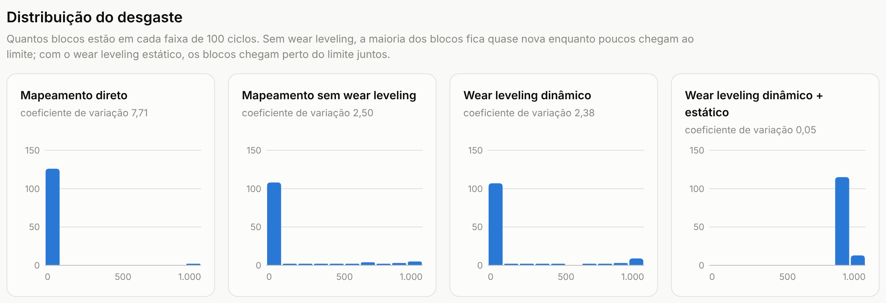
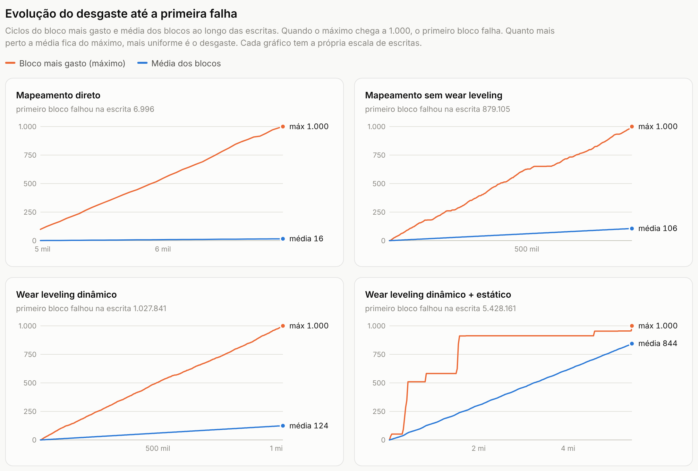
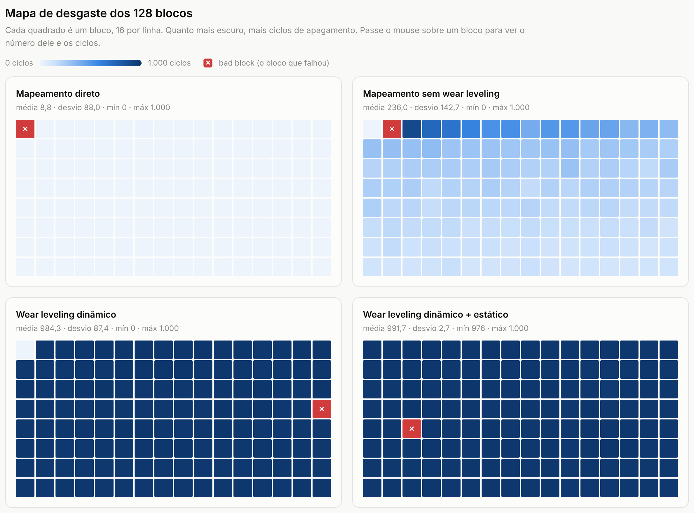

# Resultados e análise (Etapa 10)

Este documento responde ao problema de pesquisa: **o wear leveling aumenta a vida útil de um
pendrive NAND, e a que custo?** Os números vêm de `./simulador --comparar`, que também gera a
tela de resultados [resultados.html](resultados.html) (abra no navegador para ver os gráficos
interativos).

## Como os testes foram feitos

- Dispositivo: 128 blocos de 64 páginas de 2 KB (16 MB), limite de 1.000 ciclos P/E por bloco.
  A FTL reserva 8 blocos (over-provisioning), então o sistema enxerga 7.680 LBAs.
- Cada modo da FTL recebe **exatamente a mesma sequência de escritas** (semente fixa) e roda até
  o **primeiro bloco chegar a 1.000 ciclos** e virar bad block.
- Modos comparados:
  - **Direto**: o LBA n fica sempre na mesma página física; regravar exige apagar o bloco.
  - **Mapeamento sem WL**: tabela LBA → PBA e garbage collection, sem olhar o desgaste.
  - **WL dinâmico**: escolhe o bloco livre menos gasto.
  - **WL dinâmico + estático**: também move dados frios de blocos pouco gastos para blocos gastos.
- Duas cargas:
  - **Uso de pendrive** (sistema de arquivos da Etapa 7): fotos e músicas ocupam 60% do disco e
    nunca mudam; documentos pequenos são editados (70%), criados (20%) e apagados (10%), e toda
    operação regrava os metadados do sistema de arquivos.
  - **Dados quentes**: o disco é preenchido uma vez e depois 90% das escritas vão para os LBAs 0 a 3
    e 10% para LBAs aleatórios.

"Escritas" nas tabelas são as escritas lógicas da fase de uso (depois da cópia inicial) até a
primeira falha. "Ganho" compara com o mapeamento sem wear leveling.

## Uso de pendrive (sistema de arquivos)

| Modo | Escritas | Ganho | Média P/E | Desvio | CV | Mín | Nunca apagados | Vida usada | WA |
|---|---|---|---|---|---|---|---|---|---|
| Direto | 2.013 | 0,002× | 15,9 | 122,5 | 7,71 | 0 | 125 | 1,6% | 59,18 |
| Mapeamento sem WL | 874.122 | 1× | 106,3 | 265,5 | 2,50 | 0 | 102 | 10,6% | 1,00 |
| WL dinâmico | 1.022.858 | 1,17× | 124,5 | 296,5 | 2,38 | 0 | 101 | 12,4% | 1,00 |
| WL dinâmico + estático | **5.423.178** | **6,2×** | 844,2 | 40,5 | 0,05 | 813 | 0 | **84,4%** | 1,01 |



*Figura 1: destaque, escritas até a primeira falha e vida aproveitada no uso de pendrive.*



*Figura 2: mapa de desgaste dos 128 blocos (quanto mais escuro, mais ciclos; ✕ = bloco que falhou).*

O que os números mostram:

1. **Direto**: o pendrive morre depois de cerca de 2 mil escritas. Cada escrita de 2 KB obriga a
   apagar e regravar o bloco inteiro (WA de 59), e só os blocos dos metadados e dos documentos se
   desgastam: 125 dos 128 blocos nunca foram apagados.
2. **Mapeamento sem WL**: tirar o apagamento de cada escrita multiplica a vida por mais de 400.
   Mas o desgaste continua concentrado: as fotos e músicas ocupam 60% do disco e os blocos delas
   nunca ficam livres, então os documentos giram sempre nos mesmos ~26 blocos (102 nunca apagados).
3. **WL dinâmico**: quase não ajuda nesta carga (+17%). Ele só escolhe entre blocos **livres**,
   e os blocos com dados frios nunca ficam livres.
4. **WL estático**: move as fotos e músicas para os blocos gastos e libera os blocos novos para os
   documentos. Resultado: **6,2 vezes mais escritas** que sem wear leveling, todos os blocos com
   pelo menos 813 ciclos e 84% da vida total aproveitada. O custo é pequeno: 23.369 migrações
   (62.440 páginas copiadas) em 5,4 milhões de escritas, WA de 1,00 para 1,01.



*Figura 3: quantos blocos em cada faixa de 100 ciclos. Só o estático junta todos os blocos perto do limite.*



*Figura 4: ciclos do bloco mais gasto e média dos blocos ao longo das escritas. A falha acontece quando o
máximo chega a 1.000; no estático a média acompanha o máximo.*

## Dados quentes

| Modo | Escritas | Ganho | Média P/E | Desvio | CV | Mín | Nunca apagados | Vida usada | WA |
|---|---|---|---|---|---|---|---|---|---|
| Direto | 1.132 | 0,002× | 8,8 | 88,0 | 9,95 | 0 | 42 | 0,9% | 63,94 |
| Mapeamento sem WL | 625.777 | 1× | 236,0 | 142,7 | 0,60 | 0 | 1 | 23,6% | 3,09 |
| WL dinâmico | 2.601.162 | 4,2× | 984,3 | 87,4 | 0,09 | 0 | 1 | 98,4% | 3,10 |
| WL dinâmico + estático | **2.620.210** | **4,2×** | 991,7 | 2,7 | 0,003 | 976 | 0 | **99,2%** | 3,10 |



*Figura 5: mapa de desgaste com dados quentes. O dinâmico já espalha o desgaste; o estático corrige o
único bloco que ficou parado.*

Aqui os 10% de escritas aleatórias acabam mudando todos os dados de vez em quando, então quase todo
bloco fica livre em algum momento e o **dinâmico já resolve**: 4,2 vezes mais escritas e 98% da vida
usada. O estático só elimina o desequilíbrio que sobra (o bloco com os dados que nunca mudaram, e o
desvio cai de 87,4 para 2,7 ciclos), com apenas 90 migrações. A WA de 3,1 nos modos com mapeamento vem
do disco cheio: o GC precisa copiar páginas válidas dos blocos vítimas.

## Conclusão

- Qualquer FTL com mapeamento já é centenas de vezes melhor que o mapeamento direto.
- O **wear leveling dinâmico** basta quando todos os dados mudam de vez em quando (cenário quente: 4,2×).
- Quando há **dados frios de verdade**, como fotos e músicas num pendrive, só o **wear leveling
  estático** aproveita os blocos que guardam esses dados: 6,2× mais vida que sem wear leveling, contra
  1,17× do dinâmico.
- O custo do estático é baixo: cerca de 1% de escritas extras na NAND.

## Como reproduzir

```sh
make
./simulador --comparar        # cerca de 2 minutos; abre resultados.html no navegador
```

Os CSVs (`fs_*.csv` e `quente_*.csv`) ficam na pasta onde o simulador rodou.
